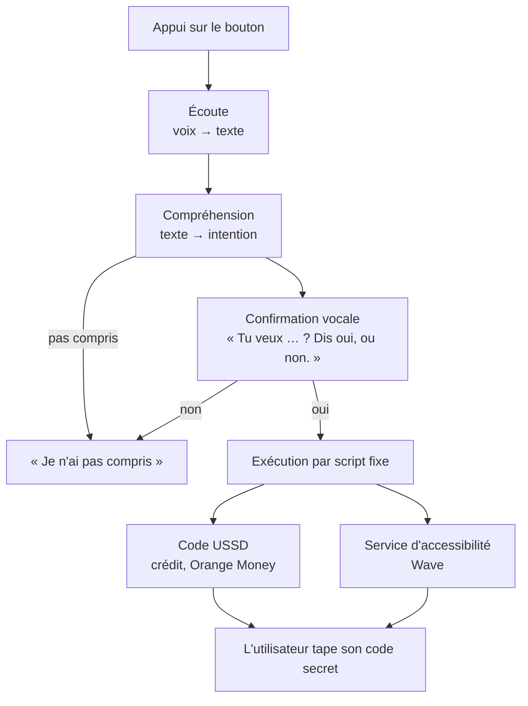

# Architecture

## L'idée en une phrase

L'utilisateur parle, l'appli transforme sa phrase en une **intention** précise, la fait **confirmer**, puis lance un **script fixe** qui prépare l'action et s'arrête avant le code secret.

## Le parcours d'une demande



Exemple : « envoie 5 000 francs à Fatou »

1. **Écoute** → `"envoie 5000 francs à Fatou"`
2. **Compréhension** → `EnvoyerArgent(montant = 5000, destinataire = "Fatou", service = WAVE)`
3. **Confirmation** → « Tu veux envoyer 5000 francs à Fatou avec Wave ? Dis oui, ou non. » → « oui »
4. **Exécution** → ouvrir Wave, appuyer sur « Envoyer », remplir le destinataire et le montant
5. **Arrêt** → l'appli dit « Vérifie, puis tape ton code secret » et ne touche plus à rien

## Les quatre blocs

Chaque bloc est derrière une interface, pour pouvoir le remplacer sans toucher au reste.

| Bloc | Dossier | Aujourd'hui (français) | Plus tard (wolof) |
|---|---|---|---|
| Écoute | `voice/SpeechToText` | reconnaissance vocale d'Android, `fr-FR` | modèle wolof (Kiriku ASR, BuzzASR…) sur un serveur |
| Parole | `voice/Speaker` | synthèse vocale d'Android | voix wolof (xTTS GalsenAI, Adia TTS) ou audios préenregistrés |
| Compréhension | `intent/IntentParser` | un LLM par API (`LlmParser`), avec les règles simples en secours (`RuleBasedParser`) | le même LLM, avec des consignes en wolof |
| Exécution | `actions/` + `accessibility/` | scripts fixes | les mêmes scripts, plus nombreux |

`MainActivity` fait le chef d'orchestre : une petite machine à états (`REPOS → ECOUTE_DEMANDE → ECOUTE_CONFIRMATION → EXECUTION`).

## Les intentions

Une intention est une demande comprise et complète. Liste actuelle (`intent/Intention.kt`) :

- `AcheterCredit(montant)`
- `EnvoyerArgent(montant, destinataire, service)` avec `service` = Wave ou Orange Money
- `Precision(question)` : il manque une information, l'appli pose la question et écoute la réponse
- `Inconnue` : l'appli demande de répéter

Ajouter une action = ajouter une intention, sa phrase de confirmation, et son script.

## L'exécution : deux moyens

### 1. Menus USSD (désactivés pour l'instant, `Config.USSD_ACTIF = false`)

L'appli compose `#144#`, puis le service d'accessibilité lit chaque écran du menu et répond à la place de l'utilisateur. `UssdNavigator` décide avec des règles fixes :

| L'écran affiche | L'agent fait |
|---|---|
| un menu numéroté | cherche la ligne voulue (« crédit », puis « moi ») et tape son numéro |
| « montant » | tape le montant confirmé à voix haute |
| « numéro », « bénéficiaire » | tape le numéro, s'il le connaît |
| « 1. Confirmer » avec le bon montant affiché | confirme |
| « code secret » | **s'arrête** et dit à l'utilisateur de le taper |
| autre chose | **abandonne** sans rien envoyer, et affiche le menu lu |

L'agent lit le menu au lieu de taper des chiffres par cœur : si Orange change l'ordre des lignes, il s'adapte ou s'arrête, mais ne choisit pas une mauvaise ligne à l'aveugle. Ça marche sans internet et sans autre appli.

### 2. Service d'accessibilité (pour Wave et les applis sans autre porte)

`AgentAccessibilityService` peut lire l'écran d'une autre appli et appuyer sur ses boutons. Il exécute un `UiScript` : une liste d'étapes écrites à la main.

```kotlin
UiScript(
    targetPackage = "com.wave.personal",
    steps = listOf(
        Step.ClickText("Envoyer"),
        Step.TypeText("Fatou"),
        Step.TypeText("5000"),
        Step.StopForUser("Vérifie, puis tape ton code secret."),
    )
)
```

Règles de ce service :

- Il n'agit que dans les applis listées dans `accessibility_service_config.xml`.
- Il ne fait rien tant qu'aucun script n'a été confirmé par l'utilisateur.
- Il abandonne si une étape ne trouve pas son bouton au bout de quelques secondes.
- Tout script finit par `StopForUser` : jamais de saisie du code secret, jamais de validation finale.

## Ce que l'IA a le droit de faire

L'IA reçoit le texte de la demande et renvoie une fiche : action, montant, destinataire, service, ou une question à poser. C'est tout. Elle ne voit pas l'écran, ne connaît pas le code secret et ne déclenche rien : la fiche passe par la confirmation vocale, puis par un script fixe.

Le texte de la demande est envoyé au fournisseur d'IA par internet. Rien d'autre ne sort du téléphone.

## Pourquoi « l'IA comprend, le script exécute »

- **Sécurité** : une IA qui se trompe peut mal comprendre une phrase, mais la confirmation vocale rattrape l'erreur. Elle ne peut pas appuyer sur un mauvais bouton, parce qu'elle n'appuie sur rien.
- **Règles du Play Store** : Google interdit qu'une appli utilise l'accessibilité pour décider et agir de façon autonome, mais tolère l'automatisation à règles fixes, avec un but étroit et clair. Il faudra aussi un écran d'explication et de consentement, et le formulaire de déclaration de Google.
- **Confiance** : l'appli fait toujours la même chose pour la même demande.

## Ce que l'appli ne fait jamais

- Lire, stocker ou taper un code secret.
- Valider un paiement à la place de l'utilisateur.
- Agir sans confirmation vocale.
- Envoyer le contenu de l'écran d'une autre appli sur internet (le mode réglage produit un relevé que l'utilisateur choisit lui-même de partager).

## Risques connus

| Risque | Conséquence | Parade |
|---|---|---|
| Wave protège ses écrans contre l'accessibilité | l'envoi Wave ne marche pas | tester en premier ; sinon ouvrir Wave et guider à la voix |
| Wave change son interface | le script casse | scripts courts, textes des boutons dans un seul fichier, abandon propre |
| Refus du Play Store | pas de distribution | usage étroit, consentement clair, scripts fixes |
| Mauvaise reconnaissance vocale (surtout en wolof) | mauvaise action | confirmation obligatoire, montants répétés à voix haute |
| Fraude : quelqu'un dicte à la place du propriétaire | perte d'argent | le code secret reste manuel |

## Arborescence

```
app/src/main/java/sn/jappale/
├── MainActivity.kt            chef d'orchestre, bouton unique
├── Config.kt                  codes USSD, noms de paquets, textes des boutons
├── voice/
│   ├── SpeechToText.kt        interface + version Android (français)
│   └── Speaker.kt             synthèse vocale
├── intent/
│   ├── Intention.kt           les demandes possibles + phrases de confirmation
│   ├── IntentParser.kt        interface
│   ├── LlmParser.kt           compréhension par IA (API compatible OpenAI)
│   ├── LlmReponse.kt          consigne donnée à l'IA et lecture de sa réponse
│   └── RuleBasedParser.kt     compréhension par règles, en secours
├── actions/
│   └── ActionRunner.kt        choisit USSD ou script d'accessibilité
└── accessibility/
    ├── UssdNavigator.kt       règles pour répondre aux menus USSD
    ├── UiScript.kt            étapes d'un script
    └── AgentAccessibilityService.kt
```
